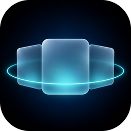
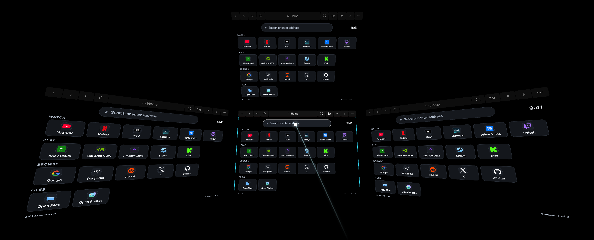

<p align="center">
  
</p>

<h1 align="center">Halopane</h1>

<p align="right"><a href="https://buymeacoffee.com/KoksalBerkay"></a></p>

<p align="center"><b>A multi-screen spatial workspace for VITURE XR glasses, running entirely on your iPhone.</b></p>

Open up to four screens and pin them in the space around you. They stay where you put them while you turn your head (3DoF head tracking), so you can keep a video on your left, a document in front of you and a chat on your right, and just look from one to the other.

Each screen is a full browser, and your iPhone is the remote for all of it. Slide your thumb to move the pointer, tap to click, or point the phone at a screen like a laser pointer. Use the phone to type, scrub video and switch screens. The same workspace plays your spatial photos and videos in real 3D and runs cloud games on a giant screen. No computer, no cameras, no extra hardware.



*Simulated wide view of the workspace. In the glasses, turn your head to look between screens.*

> [!NOTE]
> Halopane is an independent, unofficial project. It is not affiliated with, sponsored by or endorsed by VITURE. It is installed by sideloading and is not on the App Store.

## ✨ What you can do

- 🖥️ **Work across several screens at once.** Up to four screens pinned around you, each a full browser. Look between them by turning your head, or make one fill your view. Recenter brings the whole workspace back in front of you.
- 📱 **Control it all with the phone in your hand.** Use it as a trackpad (slide, tap, two fingers to scroll, two-finger tap to right-click), or aim it at a screen like a laser pointer. Gaze + tap is experimental. The phone is also your keyboard and your playback remote. The web page normally stays in the glasses. The phone also shows settings, pickers and some sign-in pages.
- 🎬 **Watch video properly.** Fill your view with supported web video, or choose a 3D layout for video that already contains two eye views.
- 🥽 **Relive your own spatial media.** Apple spatial photos and videos in real stereo, side-by-side 3D, and 180° or 360° video you look around in, opened straight from Photos or Files.
- 🎮 **Play cloud games.** Xbox Cloud Gaming and GeForce NOW with a paired controller.
- 🛡️ **Block ads your way.** A built-in list based on EasyList, plus your own filter lists and rules, managed in the app.

## 🔬 What makes it different

Halopane works without a vendor SDK.

- **Head tracking without a vendor kit.** Halopane reads fused head orientation from the adapter over Bluetooth. The observed stream carries about 62.5 pose updates per second; the display refresh is separate. The [protocol notes](docs/adapter-protocol.md) describe the messages.
- **Live web pages, not a mirrored screen.** Each screen hosts a live WebKit page. As you move your head, the display updates its perspective. In side-by-side mode, ordinary browser content is duplicated for the other eye.
- **A pointer that reaches into the glasses.** The pages you see are not on a touchscreen, so Halopane maps phone input to the page in the glasses. Support for page controls and text entry depends on the site.
- **True stereo playback.** Apple spatial video is decoded as two separate eye views and sent to the matching eye. 180° and 360° video is reprojected live as you look around.
- **Everything on the phone.** Tracking, rendering, browsing and decoding all run on the iPhone. You need a Mac to build from source.
- **A filter-list converter on the device.** Standard ad-block lists are converted on the phone into the format iOS understands, so you can bring your own.

Automated tests cover geometry, input routing, filter conversion and adapter packets. The Mac checks exercise WebKit, Metal and media decoding. Testing the glasses and sideloading still takes an iPhone.

## 🧰 What you need

| | Tested with |
|---|---|
| Glasses | VITURE Luma Ultra |
| Adapter | VITURE USB-C XR Charging Adapter Ultra |
| Phone | iPhone 16 Pro Max |
| Sideloading | [LiveContainer](https://github.com/LiveContainer/LiveContainer) |

That is the only setup Halopane has been tested on so far.

- **Other VITURE glasses** used with the same adapter should work, because head tracking comes from the adapter. VITURE lists the adapter as compatible with all its XR glasses, including the Pro, Pro 2, Luma, Luma Pro, Luma Cyber, Luma Ultra and The Beast. Only the Luma Ultra has been tested.
- **Other adapters and other brands of glasses** are not expected to have head tracking. This includes the older VITURE USB-C XR Charging Adapter and Charging Adapter Pro. The picture may still appear, but panels will not stay in place.
- **The iPhone needs a USB-C port** with video output: iPhone 15 or later, except the iPhone 16e, iPhone 17e and iPhone Air. The app targets iOS 16 and later; not every feature is available on iOS 16, and older iOS versions have not been tested.

Tried a different setup? Please open an issue and say what happened, whether it worked or not. That is how this table grows.

## 📦 Install

1. Get `Halopane.ipa`, or [build it from source](#-build-from-source).
2. Import the IPA into [LiveContainer](https://github.com/LiveContainer/LiveContainer). Other sideloading tools have not been tested.
3. In LiveContainer, open Halopane's app settings and turn on **Fix File Picker**. Without it, photos and videos from the iPhone may not open.
4. Plug the adapter into the iPhone and the glasses into the adapter.
5. Open Halopane and allow Bluetooth when asked. Bluetooth is how the adapter reports where your head is pointing.

## 🚀 First five minutes

1. Put the glasses on, look straight ahead and press **Recenter** on the phone.
2. Slide one finger on the phone to move the cursor. Tap to click. Drag two fingers to scroll.
3. Pick a site from Home, or press **Keyboard** and type an address.
4. Press **+** to add another screen, then turn your head to look at it.
5. Press the Full Screen button to make the current screen fill your view.

The [guide](docs/guide.md) covers video, 3D, Spatial Player and ad blocking.

## 📊 Status

Halopane is early software made by one person. This is what to expect today.

| Area | State |
|---|---|
| Multi-screen workspace with 3DoF head tracking | ✅ Works |
| Phone trackpad and keyboard | ✅ Works |
| Web video and Video view | ✅ Works on tested sites |
| Protected streaming (FairPlay) | 🟡 Works on Pluto TV and Plex; subscription services untested |
| Packed 3D in the browser | 🟡 Available; needs more device testing |
| Apple spatial photos and videos | ✅ Flat playback tested in Spatial Player |
| Local 180° and 360° video | 🟡 Available; needs more device testing |
| Xbox Cloud Gaming, GeForce NOW | ✅ Works with a controller |
| Amazon Luna | ⚪ Untested |
| Custom ad-block lists | 🟡 Works on the Mac test rig; iPhone check pending |
| YouTube 360° | ❌ Not supported yet |

See [known issues](docs/known-issues.md) for details and workarounds.

## 🛡️ Ad blocking

Halopane ships with a conservative list derived from EasyList and EasyPrivacy. In **More (⋯) → Ad blocking** on the phone, you can also:

- add filter lists from Files or from an HTTPS address, in Adblock Plus / EasyList format or WebKit content-blocker JSON
- write your own rules, one per line
- switch blocking off for a single site
- export everything to one file and import it again

Halopane contacts a list's address only when you add it or press Update. Some advanced filter rules cannot be expressed on iOS; they are skipped, and the app tells you how many. More in [docs/ad-blocking.md](docs/ad-blocking.md).

## 🔒 Privacy

Halopane has no accounts, no analytics and no server of its own. WebKit loads the pages you open and the resources those pages request. Halopane also fetches and occasionally refreshes Home icons from websites and their icon hosts, including in the background. It downloads a filter list only when you add it or tap Update. The rendering and input lab in Advanced settings can load a bundled test page without a network connection. If you enter a web address there or choose the Xbox test address, WebKit loads it like any other page. The report you can share from Settings names only well-known services, and leaves out other sites, page titles, files and typed text.

## 🛠️ Build from source

Open a terminal in the Halopane source folder on a Mac with Xcode. The app runs entirely on the iPhone.

```sh
./build-ipa.sh                              # writes artifacts/Halopane.ipa (unsigned)
swift test                                  # geometry and app logic
swift test --package-path AdapterTracking   # adapter protocol and pose handling
```

Harnesses that exercise WebKit, Metal and media decoding on the Mac live in `Verification/`.

## 🗺️ How it is organised

| Path | What is there |
|---|---|
| `AdapterTracking/` | Reads head orientation from the adapter over Bluetooth |
| `Sources/SpatialMath/` | Geometry: panel placement, projection, pointer hit testing |
| `Sources/App/` | App startup, the glasses display, the scene and settings screens |
| `Sources/Browser/Core/` | Each screen's browser: pages, input, toolbar, placement, report |
| `Sources/Browser/Rendering/` | Drawing screens in the glasses |
| `Sources/Browser/Phone/` | The iPhone controller: trackpad, menus, settings |
| `Sources/Browser/Web/` | Search, video, files, Home shortcuts, cloud gaming |
| `Sources/AdBlocking/` | Ad blocking lists and settings |
| `Sources/Media/` | Spatial Player for local photos and videos |
| `Sources/Diagnostics/` | Input and rendering experiments |
| `Sources/PrivateWebPortal/` | Objective-C bridge to private iOS touch and view interfaces |
| `Resources/` | Home page, injected page scripts, bundled filter rules |
| `Verification/` | Mac test harnesses |
| `docs/` | Guide, known issues, adapter protocol notes |

## ⚠️ Good to know before you rely on it

- **Unofficial hardware use.** Halopane sends the adapter three commands observed from the vendor's app: `0x0212` and `0x0211` with empty payloads, then `0x0015` with payload `01`. It can resend the last command if tracking stalls. It still comes with no warranty. Use it at your own risk.
- **Private iOS interfaces.** Halopane uses undocumented iOS features, to deliver touches to web pages shown in the glasses, keep eligible links in the browser, turn on WebKit's protected media support and support an alternate display mode in the rendering and input lab. Apple does not allow these in App Store apps, which is why Halopane is sideload-only, and an iOS update can break it.
- **Site identity.** For cloud gaming and streaming sites, Halopane changes how the browser identifies itself so those services offer their web players. You can change this per site from a screen's toolbar menu.

## 🤝 Contributing

Bug reports, hardware reports and pull requests are welcome. If you would like to support the project, you can [buy me a coffee](https://buymeacoffee.com/KoksalBerkay). Please read [CONTRIBUTING.md](CONTRIBUTING.md) first. Two rules matter most: say if AI wrote part of your change and which model, and never post Bluetooth captures or device identifiers.

## 📄 Licence

Copyright © 2026 Koksal Berkay Denktas.

Halopane's code is licensed under [GPL-3.0-or-later](LICENSE). You are free to use, study, change and share it. If you distribute it or something built from it, you must share your source under the same licence.

The bundled filter rules are derived from EasyList and EasyPrivacy and remain under CC BY-SA 3.0. Other third-party credits are in [NOTICE](NOTICE).

VITURE, Luma Ultra and all other product names and logos belong to their owners and are used here only to describe compatibility.
